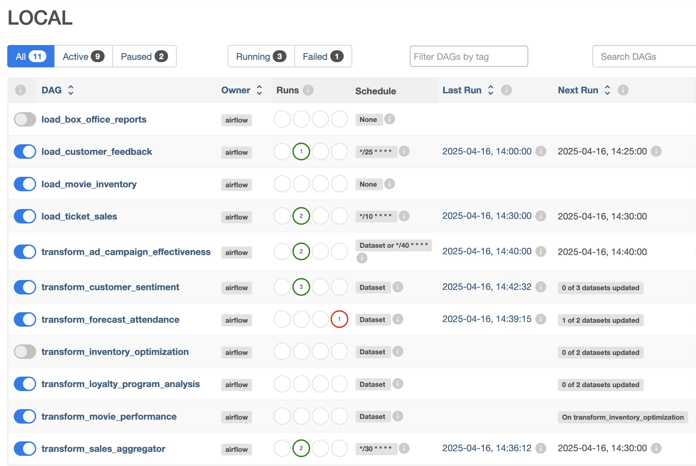

# Airflow MCP

This project implements an MCP server for Apache Airflow, enabling users to interact with their orchestration platform using natural language.

With a few minutes of setup, you should be able to use Claude Desktop or any MCP-enabled LLM to ask questions like:
- "What DAGs do we have in our Airflow cluster?"
- "What is our latest failed DAG?"
- "Show me all versions of the transform_sales_aggregator DAG"
- "Which assets are produced by our load DAGs?"

## About MCP and Airflow MCP

The Model Context Protocol (MCP) is an open standard creating secure connections between data sources and AI applications. This repository provides a custom MCP server for Apache Airflow that transforms how teams interact with their orchestration platform through natural language.

**Supports Airflow 2 and Airflow 3.** Set `airflow_version=3` in your environment to enable the Airflow 3 API (`/api/v2`) and JWT authentication automatically.

## 🚀 Features

- Query pipeline statuses through natural language
- Troubleshoot DAG failures efficiently
- Retrieve comprehensive DAG information
- Trigger DAGs based on their status
- Monitor execution results
- Analyze DAG components and configurations
- Browse Airflow variables, pools, and connections
- Inspect task instances for any DAG run
- **Airflow 3:** DAG version history, Asset (Dataset) catalog

## 🛠️ Getting Started

### Prerequisites

If you already have an Airflow instance and want to use our prebuilt Docker image, you only need:
- Docker
- Access to your Apache Airflow instance (Airflow 2 or Airflow 3)
- LLM access (Claude, ChatGPT, or AWS Bedrock)

This repository also provides a local setup for Apache Airflow, which you can use for demo purposes.

### Quick Start - Using the Prebuilt Docker Image

Configure Claude Desktop to connect to your Airflow instance. If you haven't configured Claude Desktop for use with MCP before, follow the [Claude Desktop documentation](https://modelcontextprotocol.io/quickstart/user).

**Airflow 2:**
```json
{
  "mcpServers": {
    "airflow_mcp": {
      "command": "docker",
      "args": ["run", "-i", "--rm",
               "-e", "airflow_base_url",
               "-e", "airflow_username",
               "-e", "airflow_password",
               "-e", "airflow_version",
               "pondered/airflow-mcp:latest"],
      "env": {
        "airflow_base_url": "http://host.docker.internal:8088",
        "airflow_username": "airflow",
        "airflow_password": "airflow",
        "airflow_version": "2"
      }
    }
  }
}
```

**Airflow 3** (uses `/api/v2` and JWT authentication automatically):
```json
{
  "mcpServers": {
    "airflow_mcp": {
      "command": "docker",
      "args": ["run", "-i", "--rm",
               "-e", "airflow_base_url",
               "-e", "airflow_username",
               "-e", "airflow_password",
               "-e", "airflow_version",
               "pondered/airflow-mcp:latest"],
      "env": {
        "airflow_base_url": "http://host.docker.internal:8080",
        "airflow_username": "airflow",
        "airflow_password": "airflow",
        "airflow_version": "3"
      }
    }
  }
}
```

### Running MCP Locally with Claude Desktop

1. Clone this repository:
   ```
   git clone https://github.com/ponderedw/airflow-mcp
   ```

2. If you don't have a running Airflow environment, start one with:
   ```
   just airflow
   ```

   This will start an Airflow instance on port 8088, with username `airflow` and password `airflow`.

   You can access Airflow at http://localhost:8088/ and see multiple DAGs configured:

   

   These DAGs have complex dependencies, some running on a schedule and some using Airflow's Dataset/Asset functionality.

3. Configure Claude Desktop as shown in the Quick Start section above.

4. Test your setup by asking Claude: "What DAGs do we have in our Airflow cluster?"

## Environment Variables

| Variable | Required | Description |
|---|---|---|
| `airflow_base_url` | Yes | Base URL of your Airflow instance (e.g. `http://localhost:8080`) |
| `airflow_username` | Yes | Airflow username |
| `airflow_password` | Yes | Airflow password |
| `airflow_version` | No | `2` (default) or `3` — selects API version and auth method |
| `POST_MODE` | No | `true` to enable DAG trigger and pause/unpause tools (default: `false`) |
| `AIRFLOW_INSIGHTS_MODE` | No | `true` to enable schedule-prediction tools (requires the schedule-insights plugin) |
| `TOKEN` | No | Bearer token to protect the MCP server's own SSE endpoint |
| `TRANSPORT_TYPE` | No | `sse` or `stdio` (default: `stdio`) |
| `AIRFLOW_ASSISTENT_AI_CONN` | No | Alternative connection string: `username:password@base_url` |

## 🔧 Available Tools

### Read tools (always enabled)

| Tool | Description |
|---|---|
| `get_dags` | List all DAGs |
| `get_dag` | Full details for a single DAG |
| `get_dags_tasks` | All tasks defined in a DAG |
| `get_dags_task` | Details for a single task |
| `get_dags_script` | Source code of a DAG file |
| `get_all_the_runs_for_dag` | 25 most recent runs for a DAG |
| `get_all_the_runs` | Filtered runs across multiple DAGs |
| `get_task_instances` | Task instances for a specific DAG run |
| `get_connections` | All Airflow connections |
| `get_variables` | All Airflow variables |
| `get_variable` | A single Airflow variable by key |
| `get_pools` | All resource pools and slot usage |

### Write tools (require `POST_MODE=true`)

| Tool | Description |
|---|---|
| `trigger_dag` | Trigger a new DAG run |
| `change_dags_pause_status` | Pause or unpause one or all DAGs |

### Airflow 3 only (enabled automatically when `airflow_version=3`)

| Tool | Description |
|---|---|
| `get_dag_versions` | All recorded versions of a DAG |
| `get_dag_version` | A specific DAG version by number |
| `get_assets` | All Assets (formerly Datasets) |

### Schedule Insights tools (require `AIRFLOW_INSIGHTS_MODE=true`)

| Tool | Description |
|---|---|
| `insights_get_dags_next_run` | Predicted next run time for a DAG |

> Requires the [airflow-schedule-insights](https://github.com/ponderedw/airflow-schedule-insights) plugin installed in your Airflow environment.

## 📝 Example Usage

- "What DAGs do we have in our Airflow cluster?"
- "Identify all DAGs with failed status in their most recent execution and trigger a new run for each one"
- "What operators are used by the transform_forecast_attendance DAG?"
- "Has the transform_forecast_attendance DAG ever completed successfully?"
- "Show me all versions of the load_ticket_sales DAG and what changed"
- "Which assets does the load_box_office_reports DAG produce?"
- "What variables are configured in Airflow?"

## Running MCP with LangChain

You can use `from langchain_mcp_adapters.client import MultiServerMCPClient` to add Airflow MCP as one of your tools in a LangChain app.

### Option 1: Separate Container (SSE Transport)

```python
mcp_host = os.environ.get('mcp_host', 'mcp_sse_server:8000')
mcps = {
    "AirflowMCP": {
        "url": f"http://{mcp_host}/sse",
        "transport": "sse",
        "headers": {"Authorization": f"Bearer {os.environ.get('MCP_TOKEN')}"}
    }
}
```

### Option 2: Embedded Server (STDIO Transport)

Install the library first: `pip install airflow-mcp-ponder`

```python
mcps = {
    "AirflowMCP": {
        'command': "python",
        'args': ["-m", "airflow_mcp_ponder.mcp_airflow"],
        "transport": "stdio",
        'env': {k: v for k, v in {
            'AIRFLOW_ASSISTENT_AI_CONN': os.getenv('AIRFLOW_ASSISTENT_AI_CONN'),
            'airflow_base_url': os.getenv('airflow_base_url'),
            'airflow_username': os.getenv('airflow_username'),
            'airflow_password': os.getenv('airflow_password'),
            'airflow_version': os.getenv('airflow_version'),
            'AIRFLOW_INSIGHTS_MODE': os.getenv('AIRFLOW_INSIGHTS_MODE'),
            'POST_MODE': os.getenv('POST_MODE'),
            'TRANSPORT_TYPE': 'stdio',
        }.items() if v is not None}
    }
}
```

### Using the Tools

```python
client = MultiServerMCPClient(mcps)
tools = await client.get_tools()
```

## 🤝 Contributing

We enthusiastically invite the community to contribute to this open-source initiative! Whether you're interested in:

- Adding new features
- Improving documentation
- Enhancing compatibility with different LLM providers
- Reporting bugs
- Suggesting improvements

Please feel free to submit pull requests or open issues on our GitHub repository.

## 🔗 Links

- [GitHub Repository](https://github.com/ponderedw/airflow-mcp)
- [Docker Repository](https://hub.docker.com/repository/docker/pondered/airflow-mcp/general)
